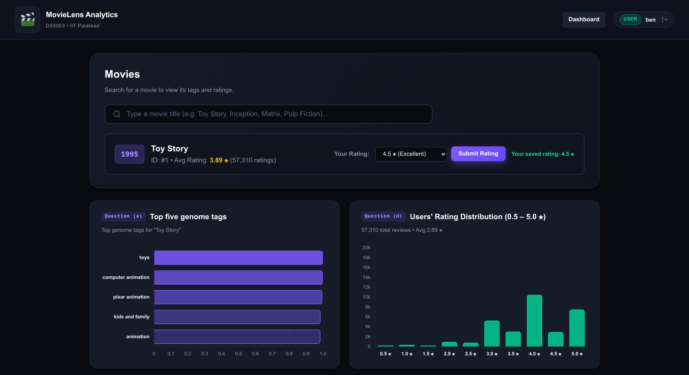

# MovieLens Analytics

A Flask and MongoDB dashboard for MovieLens 25M, with user and administrator accounts.
Data Engineering course project, IIT Palakkad.

## Requirements

- **Python 3.12+**. On Windows, enable **Add Python to PATH** during installation.
- **Linux x64** with Ubuntu 22.04-compatible libraries, **Windows 11 / Server 2022+ x64**, or **macOS 15+** (Intel or Apple Silicon).
- Internet access and several GB of free disk space.

No uv, Docker, WSL or preinstalled MongoDB is required.

## Setup

Download **Code → Download ZIP** and extract it, or clone this repository:

```sh
git clone https://github.com/beeegee/movielens-data-engineering.git
cd movielens-data-engineering
```

Open a terminal in the project folder. **Run all commands from the repository root** (the folder containing `install.py`).

### macOS / Linux

```sh
python3 install.py
python3 run.py
```

### Windows (PowerShell or Command Prompt)

```powershell
python install.py
python run.py
```

The first installation downloads native MongoDB and imports the full **25 million ratings**; allow time for it to finish. No virtual-environment activation is needed.

Open **http://localhost:5008**. Find your generated login credentials in the local `.env` file:
- User: `USER_USERNAME` and `USER_PASSWORD`
- Administrator: `ADMIN_USERNAME` and `ADMIN_PASSWORD`

Keep `.env` private. Press **Ctrl+C** in the terminal to stop the app and its managed MongoDB process. For later runs, use only the `run.py` command for your OS.

For recovery, troubleshooting and tests, see the [advanced setup guide](docs/SETUP.md).
This is a local course demonstration, not a production deployment.

## Screenshots

<details>
<summary>User and administrator dashboards</summary>




</details>
