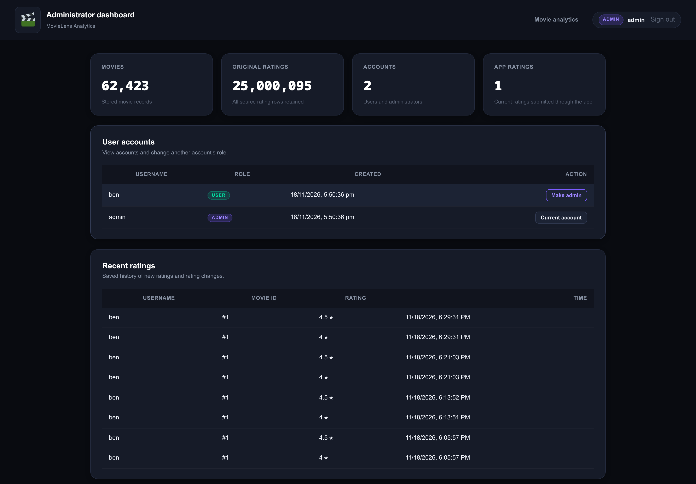

# MovieLens Analytics

Data Engineering, IIT Palakkad. A Flask, MongoDB and Chart.js dashboard for the complete MovieLens 25M dataset, with regular-user and administrator accounts.

## Before you start

- **Python 3.12 or newer**, with `venv` and pip support. Python 3.12 is the tested version.
- **Linux x86_64**, or an x86_64 Linux environment in **WSL2 on Windows**. The automatic MongoDB installer does not support native Windows, macOS or ARM.
- An internet connection and several GB of free disk space. First setup downloads the full dataset and imports all 25 million ratings, so it takes time. It is not a tiny sample dataset.
- Git is optional. You can also use **Code → Download ZIP** on GitHub and extract it.

You do **not** need uv, Docker, Node.js or a preinstalled MongoDB server. Python dependencies and the MongoDB runtime stay inside this project. The setup script does not install system packages.

On Ubuntu 24.04, including Ubuntu 24.04 inside WSL2, install the Python prerequisites if missing:

```sh
sudo apt update
sudo apt install python3 python3-venv
```

## Install

Clone this repository, or extract the downloaded ZIP. Open a terminal in the project folder:

```sh
git clone https://github.com/beeegee/movielens-data-engineering.git
cd movielens-data-engineering
python3 install.py
```

If you downloaded a ZIP, skip the `git clone` command and open its extracted folder instead.

The installer creates `.venv`, installs the pinned dependencies with standard pip, generates a private `.env`, downloads and verifies MongoDB and MovieLens, and imports the complete dataset into a local single-node replica set. Let it finish before starting the app. No shell activation is needed.

**To retry downloads or dependency installation, run `python3 install.py` again.** Completed imports, accounts and app ratings are preserved. A partially imported database needs the explicit recovery procedure below. Normal setup never resets your data automatically.

## Run

```sh
.venv/bin/python scripts/manage.py run
```

Open **http://127.0.0.1:5008**. Open the generated `.env` locally for `ADMIN_USERNAME`, `ADMIN_PASSWORD`, `USER_USERNAME` and `USER_PASSWORD`. These are generated credentials, not passwords published in this repository. Do not share `.env` or show it in screenshots.

Regular users can explore movies and rate them. Administrators can open `/admin` to inspect accounts, change another account's role and view rating history.

Press **Ctrl+C** to stop the app and any MongoDB process started by this command. A MongoDB instance that was already running is not stopped. This is a local course demonstration, not a production deployment. Keep it bound to localhost.

## Manual installation

If you prefer to run the individual steps, use ordinary Python and pip:

```sh
python3 -m venv .venv
.venv/bin/python -m pip install -r requirements.txt
.venv/bin/python scripts/manage.py setup
.venv/bin/python scripts/manage.py run
```

Use either this route or `install.py`, not both. No `uv` commands are needed.

## Recovering an interrupted import

If setup reports **`Existing or incomplete dataset; explicit --reset required`**, ordinary reruns cannot resume that partial database import. Stop the app first, then explicitly restart ingestion:

```sh
python3 install.py --reset-data
```

**This replaces dataset collections and removes current app ratings and rating history. User accounts are preserved.** It reuses completed downloads and starts the import again from the beginning. Use it only when you accept that data loss. Normal installation never enables this option automatically.

## Troubleshooting

- **`python3` is missing or too old:** install Python 3.12 with its matching `venv` package. Reopen your terminal and check `python3 --version`.
- **`ensurepip` or `venv` is missing:** on Ubuntu, install `python3-venv` for the interpreter you are using, then rerun the installer.
- **Unsupported operating system or architecture:** automatic runtime setup is Linux x86_64 only. On an x86_64 Windows machine, run the commands inside an Ubuntu WSL2 terminal, not PowerShell. Native macOS and ARM are not supported by the automatic installer.
- **A download or dependency installation fails:** check your connection, free disk space and the printed error, then rerun the same command. No global pip installation or `sudo pip` is required.
- **MongoDB cannot start:** read `.runtime/mongod.log` and `.runtime/mongodb-startup.log`. The downloaded build targets Ubuntu 22.04 x86_64; another Linux distribution must provide its required shared libraries.
- **A local port is already in use:** the default ports are 5008 for Flask and 27118 for MongoDB. Flask's port can be changed in `.env`. A custom MongoDB URI must point to an already-running replica set.

## Tests and optional browser checks

Install development dependencies without downloading data or starting MongoDB:

```sh
python3 install.py --dev --dependencies-only
```

This does not generate credentials or import data. To finish the normal setup later, run `python3 install.py`.

Installer safety checks and the database-free application smoke test:

```sh
.venv/bin/python -m pytest -q tests/test_install.py tests/test_app.py::test_import_and_anonymous_guards_without_database
```

For the full database-backed suite, finish setup and keep the app running in another terminal:

```sh
env MONGO_URI='mongodb://127.0.0.1:27118/?replicaSet=movielens-rs' TEST_MONGO_URI='mongodb://127.0.0.1:27118/?replicaSet=movielens-rs' .venv/bin/python -m pytest -q tests
```

The original application suite was verified with 51 passing tests, including real MongoDB integration. Installer tests are additional. Integration tests create and remove isolated `movielens_test_*` or `movielens_loader_test_*` databases. Tiny loader fixtures are explicitly synthetic and are not used for dashboard screenshots.

Read-only full-dataset verification, while MongoDB is running:

```sh
.venv/bin/python scripts/verify_dataset.py
```

For browser checks and screenshot regeneration, also install a local Chromium browser:

```sh
.venv/bin/python scripts/capture_dashboard.py
```

The browser check uses normal login, submits and replaces a demo rating, changes and restores the regular user's role, and saves screenshots. It changes the local demo database. Credentials and cookies are not written to its evidence files.

## Data and queries

- All 25,000,095 original ratings and 1,093,360 source user tags are retained.
- Movie documents store exact rating sums, counts, averages, histograms, external IDs and the five highest genome relevance scores. The complete original ZIP is retained.
- Genre/tag counts are prepared during ingestion. Rankings and genre views are queried from MongoDB.
- Ranking uses the mean rating. Minimum counts are 500 overall and 20 for a release year, falling to 5 if fewer than five movies qualify for that year.
- The popularity distribution includes unrated movies. Genre coverage counts movie–genre memberships.
- App accounts are separate from the dataset's numeric user IDs. A transaction updates the account's current vote, movie summary and rating-change event together.
- Passwords are hashed. Protected routes reload the role from MongoDB. Forms and JSON submissions carry CSRF tokens. There is no query-parameter login shortcut.
- Chart.js is vendored locally. The dashboard needs no font or chart-library CDN.

## Screenshots

### User dashboard

Movie search, personal ratings, genome tags and the rating distribution.


### Administrator dashboard

Dataset totals, account roles and rating history. The screenshot shows local demo accounts.



## Files

- `load_data.py`: chunked ingestion, cleaning, summaries, indexes and account seeding.
- `app.py`: login, permissions, analytics APIs and rating transactions.
- `templates/`, `static/`: user/admin views and charts.
- `install.py`: standard-library installer, no uv or environment activation required.
- `scripts/manage.py`: local setup, startup and shutdown.
- `tests/`: regression tests and labelled synthetic loader fixtures.
- `docs/screenshots/`: user and administrator dashboard screenshots.
- `verification/`: locally generated dataset and browser-check results, excluded from Git.

To intentionally replace dataset collections, stop the app and use the explicit `python3 install.py --reset-data` recovery command above. This also removes current app ratings and rating events. User accounts are preserved. Normal setup never resets data.
