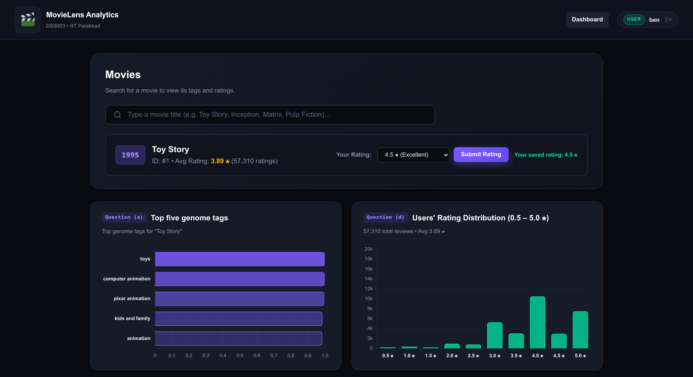
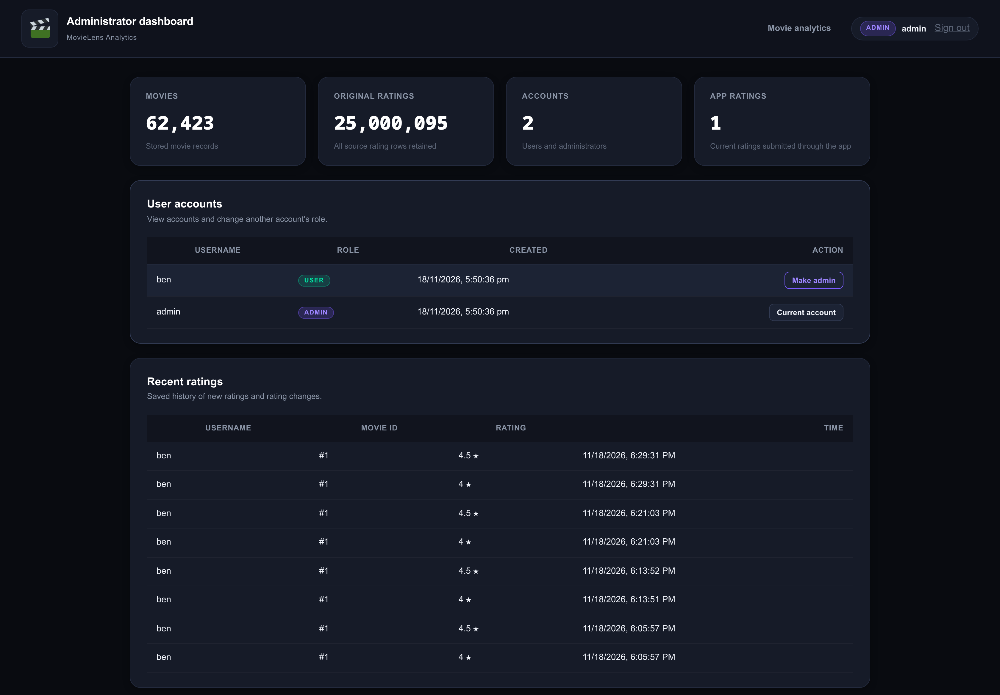

# Advanced setup and reference

Run all commands from the repository root, not the `docs/` folder.

Data Engineering, IIT Palakkad. A Flask, MongoDB and Chart.js dashboard for the complete MovieLens 25M dataset, with regular-user and administrator accounts.

## Requirements

- **Python 3.12 or newer.** Python 3.12 is the tested version. Install it from [python.org](https://www.python.org/downloads/) if needed. On Windows, enable **Add Python to PATH** in the Python installer.
- **Linux**, **Windows**, or **macOS** with an officially supported MongoDB 8.0 runtime:
  - Linux x86_64, with the shared libraries required by the Ubuntu 22.04 MongoDB build. Ubuntu 22.04/24.04 are suitable targets.
  - Windows 11 or Windows Server 2022 or newer, x64.
  - macOS 15 or newer, both Intel and Apple Silicon.
- Internet access and several GB of free disk space. First setup imports the full **25 million ratings**, not a tiny sample, and takes time.

You do **not** need uv, Docker, WSL, Homebrew, Node.js or a preinstalled MongoDB server. The installer chooses the native MongoDB download for your machine, checks the publisher's SHA-256, and keeps the runtime and Python dependencies in this folder.

## Install and run

Download this repository with **Code → Download ZIP** and extract it, or clone it with Git. Open a terminal in the extracted project folder.

### macOS or Linux

```sh
python3 install.py
python3 run.py
```

### Windows

Open PowerShell or Command Prompt in the project folder:

```powershell
python install.py
python run.py
```

Then open **http://127.0.0.1:5008**.

The installer creates `.venv`, installs the pinned Python dependencies with pip, generates a private `.env`, downloads MongoDB and MovieLens, and imports the complete dataset into a local single-node replica set. No virtual-environment activation or manual database commands are needed. `run.py` handles the Windows/Unix executable-path difference.

Open the generated `.env` locally for `ADMIN_USERNAME`, `ADMIN_PASSWORD`, `USER_USERNAME` and `USER_PASSWORD`. These credentials are generated, not published here. Do not share `.env` or show it in screenshots.

Regular users can explore movies and rate them. Administrators can open `/admin` to inspect accounts, change another account's role and view rating history.

Press **Ctrl+C** to stop the app and its project-managed MongoDB process. An externally started MongoDB instance is not stopped. This is a local course demonstration, not a production deployment. Keep it bound to localhost.

## Retrying setup

Stop the app with Ctrl+C before rerunning the installer, especially on Windows where running executables cannot be replaced. Rerun `install.py` to retry downloads or Python dependency installation. Completed imports, accounts and app ratings are preserved. Normal setup never resets data automatically.

If setup reports **`Existing or incomplete dataset; explicit --reset required`**, the partial import cannot resume. Stop the app, then explicitly restart ingestion:

```sh
python3 install.py --reset-data
```

On Windows, use `python install.py --reset-data`.

**This replaces dataset collections and removes current app ratings and rating history. User accounts are preserved.** Completed downloads are reused, but ingestion starts again from the beginning. Use this option only when you accept that data loss.

## Troubleshooting

- **Python is missing or too old:** install Python 3.12 and reopen your terminal. Check `python3 --version` on macOS/Linux or `python --version` on Windows.
- **Ubuntu reports missing `venv` or `ensurepip`:** install the matching `python3-venv` package. For Ubuntu 24.04: `sudo apt install python3 python3-venv`.
- **A download fails:** check your connection and free disk space, then rerun the same installer command.
- **MongoDB cannot start:** check `.runtime/mongod.log` and `.runtime/mongodb-startup.log`. The installer downloads the official OS-specific MongoDB build, so your OS and CPU must meet that build's requirements. On Linux, missing shared-library errors require the corresponding OS packages. On Windows, missing `VCRUNTIME`/`MSVCP` DLL errors require Microsoft's Visual C++ x64 Redistributable.
- **The default port is already in use:** Flask uses 5008 and MongoDB uses 27118. Change Flask's `PORT` in `.env` if needed. A custom `MONGO_URI` must point to an already-running replica set.
- **ARM Windows or another unsupported CPU/OS:** no native runtime is provided for that combination. The installer reports it before installing dependencies rather than silently downloading the wrong binary.

## Tests and optional browser checks

Install development dependencies without downloading the dataset or starting MongoDB:

```sh
python3 install.py --dev --dependencies-only
```

On Windows, use `python` instead of `python3`. For commands below, use `.venv/Scripts/python.exe` instead of `.venv/bin/python` on Windows.

Database-free safety checks:

```sh
.venv/bin/python -m pytest -q tests/test_install.py tests/test_runtime.py tests/test_app.py::test_import_and_anonymous_guards_without_database
```

For the full database-backed suite, finish setup and keep the app running in another terminal. Set `MONGO_URI` and `TEST_MONGO_URI` to `mongodb://127.0.0.1:27118/?replicaSet=movielens-rs`, then run:

```sh
.venv/bin/python -m pytest -q tests
```

Integration tests create and remove isolated `movielens_test_*` or `movielens_loader_test_*` databases. Tiny loader fixtures are explicitly synthetic and are not used for the README screenshots.

The GitHub Actions workflow checks native MongoDB startup, real database-backed tests, an HTTP login-page smoke test, repeat installation and clean shutdown on Linux, Windows, macOS Intel and macOS Apple Silicon. These tests use isolated fixtures, not a repeat of the full 25M import on every runner.

Read-only full-dataset verification, while MongoDB is running:

```sh
.venv/bin/python scripts/verify_dataset.py
```

For browser checks and screenshot regeneration, also install a local Chromium browser:

```sh
.venv/bin/python scripts/capture_dashboard.py
```

The browser check uses normal login, submits and replaces a demo rating, changes and restores the regular user's role, and saves screenshots. It changes the local demo database. Credentials and cookies are not written to its evidence files.

## Data and queries

- All 25,000,095 original ratings and 1,093,360 source user tags are retained.
- Movie documents store exact rating sums, counts, averages, histograms, external IDs and the five highest genome relevance scores. The complete original ZIP is retained.
- Genre/tag counts are prepared during ingestion. Rankings and genre views are queried from MongoDB.
- Ranking uses the mean rating. Minimum counts are 500 overall and 20 for a release year, falling to 5 if fewer than five movies qualify for that year.
- The popularity distribution includes unrated movies. Genre coverage counts movie–genre memberships.
- App accounts are separate from the dataset's numeric user IDs. A transaction updates the account's current vote, movie summary and rating-change event together.
- Passwords are hashed. Protected routes reload the role from MongoDB. Forms and JSON submissions carry CSRF tokens. There is no query-parameter login shortcut.
- Chart.js is vendored locally. The dashboard needs no font or chart-library CDN.

## Screenshots

### User dashboard

Movie search, personal ratings, genome tags and the rating distribution.



### Administrator dashboard

Dataset totals, account roles and rating history. The screenshot shows local demo accounts.



## Files

- `load_data.py`: chunked ingestion, cleaning, summaries, indexes and account seeding.
- `app.py`: login, permissions, analytics APIs and rating transactions.
- `templates/`, `static/`: user/admin views and charts.
- `install.py`: standard-library installer, no uv or environment activation required.
- `run.py`: starts the app using the correct virtual-environment path on your OS.
- `platform_support.py`: native runtime and executable-path selection.
- `scripts/manage.py`: local setup, startup and shutdown.
- `tests/`: regression tests and labelled synthetic loader fixtures.
- `docs/screenshots/`: user and administrator dashboard screenshots.
- `verification/`: locally generated dataset and browser-check results, excluded from Git.

To intentionally replace dataset collections, stop the app and use the explicit `python3 install.py --reset-data` recovery command above. This also removes current app ratings and rating events. User accounts are preserved. Normal setup never resets data.
